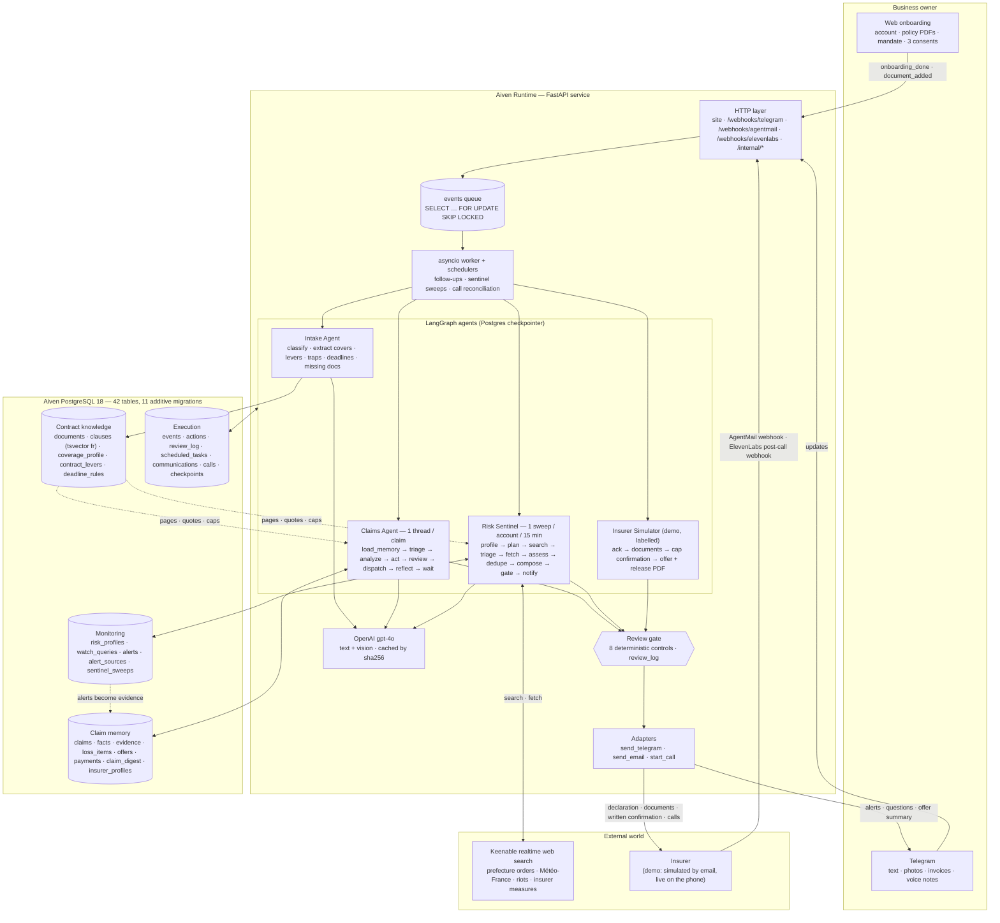
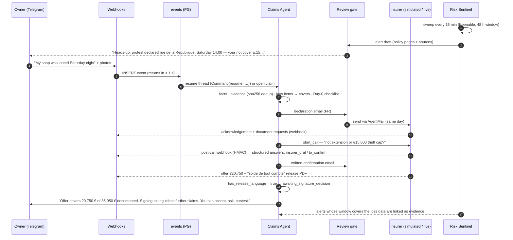

# Robin — the autonomous claims agent for small businesses

> **Your policy, your evidence, your claim — handled by your agent.**
> Four LangGraph agents, one PostgreSQL memory, a review gate that blocks any euro not traceable to a document. Deployed on Aiven Runtime. Built in one day for the Accel × Aiven *Data-Centric Agents* hackathon (Paris, 22 October 2026).

[](https://01a16307-94d9-76dc-b2cf-1a5228d5463a-8080.eur-1.aiven.app/health)


**Live:** <https://01a16307-94d9-76dc-b2cf-1a5228d5463a-8080.eur-1.aiven.app> · Telegram **@RobinClaimsBot** · [`/health`](https://01a16307-94d9-76dc-b2cf-1a5228d5463a-8080.eur-1.aiven.app/health)

---

## Table of contents

1. [The problem — and why now](#1-the-problem--and-why-now)
2. [What Robin is (and refuses to be)](#2-what-robin-is-and-refuses-to-be)
3. [Architecture](#3-architecture)
4. [The four agents](#4-the-four-agents)
5. [The data layer](#5-the-data-layer)
6. [The review gate — safety as a property of the output](#6-the-review-gate--safety-as-a-property-of-the-output)
7. [Evidence it works](#7-evidence-it-works)
8. [End-to-end demo journey](#8-end-to-end-demo-journey)
9. [Route to first users](#9-route-to-first-users)
10. [Stack, run, deploy](#10-stack-run-deploy)
11. [Repository map](#11-repository-map)
12. [Honest status](#12-honest-status)
13. [Legal note](#13-legal-note)

---

## 1. The problem — and why now

On **17–18 October 2026**, at least **3,000 shops** were looted or damaged across France (Prime Minister, Public Sénat 19/10). Insured losses are estimated at **€1–1.2 bn** (Morningstar DBRS); **70 %** of the victims are small retailers (FCD). The mandatory riot cover voted in the 2026 finance law is **not in force**. France Assureurs extended the declaration deadline to 30 days — a deadline most owners do not know exists.

What happens next is documented and brutal. In 2023 a tobacco-shop owner with **€200,000** of damage received **€55,000**. Only 53 % of shop owners knew they had business-interruption cover. Stock is declared at retail price and exposes the owner to forfeiture for false declaration. Nobody reads the 70–120 pages of general conditions; nobody follows up; the first release form gets signed.

The loss is not caused by bad policies. It is caused by **unread policies, missed deadlines and nobody chasing**. That is a data problem and a procedural problem — exactly what an agent with memory can take over.

Sources: `docs/prd/2026-10-22-robin-claims-agent/PRD.md` §1, `data/research/08c_Real_Cases_Case_Law.md` §0–§1.

## 2. What Robin is (and refuses to be)

Robin is a **pure procedural layer** under a written mandate. It does what the business owner should do themselves — read, declare, collect, transmit, follow up, document, watch — faster and without forgetting. It **never decides, never advises, never accepts**. The owner keeps every decision.

| Robin does | Robin never does |
|---|---|
| Reads the policy clause by clause and cites **page numbers** for every cover | Infers that a cover is absent because a page is missing (`unknown`, never `no`) |
| Declares the loss to the insurer on **Day 0**, with confirmed facts only | Originates or decides an amount |
| Builds a **living statement of loss**: item → evidence → clause (page) → computation | Advises, recommends, estimates "your chances" |
| Emails and **calls** the insurer, requests documents, follows up at D+7 | Accepts, agrees, waives or settles anything |
| Stores oral insurer answers as `insurer_oral / to_confirm` and asks for written confirmation | Lets an oral answer modify the coverage profile |
| **Watches external risks** around the shop and warns before and after an event, with sources | Treats silence as acceptance |
| Detects *solde de tout compte* release language in an offer and explains its effect | Collects funds (the insurer pays the owner) |

**Why this matters legally.** French case law treats paid, personalised advice on insurers' offers as unlawful practice of legal advice (Cass. 2e civ. 9 Dec 2015; CA Nîmes 7 Jul 2023; Cass. 2e civ. 7 May 2025 — PRD §2.15). The lawful side is *information à caractère documentaire*. Robin stays there **by construction**: the review gate (§6) makes it a property of every outbound message, not a marketing claim. Analysis: `data/research/09c_Legal_Perimeter_Synthesis.md`.

## 3. Architecture

One FastAPI service on Aiven Runtime: HTTP (site + webhooks) and an in-process asyncio worker. **All state is in Aiven PostgreSQL** — business data, agent memory, event queue and LangGraph checkpoints. Webhooks insert an event and return in < 1 s; the worker does the work; every tool call is audited.



### Event flow



**Design rules that hold everywhere.** Webhooks never do work, they enqueue. Agents never call each other, they communicate through the database and real channels. Every outbound text passes the gate. Every tool call writes `actions` (arguments, result, tokens, latency, cost). Nothing is overwritten: facts, loss items and coverage facts are versioned with `supersedes`.

## 4. The four agents

### Intake Agent — `app/agents/intake/`
Runs when the owner finishes onboarding or uploads a document. Six nodes: classify documents (general conditions, schedule, endorsement, IPID…), extract a **coverage profile** per guarantee (`subscribed yes/no/unknown`, cap, deductible, conditions, exclusions) with `clause_id`, **page** and verbatim quote; extract **contractual levers** (waiver of the proportional rule, assessor-fee cover, single deductible, advances) and **traps** (theft excluded during riots, repairs requiring written consent…); extract **deadline rules** with their clause; list **missing documents** as tasks. Recognises a corpus contract by hash so the 12 public contracts are never re-extracted. Particular conditions override general conditions with a new version.

### Claims Agent — `app/agents/claims/`
One LangGraph thread per claim (`thread_id = claim_id`), checkpointed in Postgres. Every run ends in a typed `interrupt()` — `awaiting_client`, `awaiting_insurer_email`, `awaiting_call_result`, `awaiting_followup`, `awaiting_signature_decision` — and the next event resumes it. A restart loses nothing. Its "brain" (`brain/`) matches each loss item to a cover, recomputes amounts (stock at purchase price, business interruption from accounting inputs), keeps a **claim digest** (open asks, how many times asked, insurer positions verbatim), and builds **insurer profiles** across claims (first-reply delay, first offer as a share of the documented total), stated as observations only. Tools: `search_clauses`, `read_document` (vision), `update_loss_statement`, `ask_client`, `send_email`, `start_call`, `schedule_followup`, `register_deadline`, `log_fact`, `request_insurer_document`, `present_offer`.

### Risk Sentinel — `app/agents/sentinel/`
The proactive agent. From the business (address → city, department), the coverage profile and the deadline rules it derives a **risk profile** and ≤ 10 localised French queries per sweep (protests and prefecture bans, riots, hail/storm/flood vigilance, nearby fires, access strikes, burglary waves, insurer/government measures). Keenable realtime search bounded to the **last 48 hours**, gpt-4o triage, page fetch with an extraction prompt, structured assessment (place, window, severity, phase upcoming/ongoing/past, cover concerned, official source), fingerprint dedup (five newspapers on one protest = one alert). The alert states facts + source URL, the owner's **own policy terms with pages and caps**, contractual conditions, precautions labelled *"general, not contractual, not advice"*, and the running declaration deadline. Past events ask whether damage occurred. Alerts whose window covers a later loss are **linked to the claim as dated third-party evidence**. Scheduler: every minute, due accounts are swept; onboarding arms monitoring automatically.

### Insurer Simulator — `app/agents/insurer_sim/` (demo only, labelled "SIMULATED INSURER" in every email)
A separate LangGraph with its own AgentMail inbox that only ever sees the emails it receives — never Robin's memory. Scripted scenario: acknowledgement with a file reference → request for invoices → written confirmation of the theft cap → **offer of €20,750 with a generated *quittance pour solde de tout compte* PDF** (to exercise release detection) → contest forwarded to the expert. Its emails pass the same banned-word gate.

## 5. The data layer

Robin is a memory model with agents on top. Three properties: **grounding** (every statement about the contract cites a clause and a page, verified before sending), **provenance** (every fact carries its source and confidence; corrections create versions), **freshness** (48-hour search window; oral answers provisional until written).

| Layer | Tables | Written by | Read by |
|---|---|---|---|
| Contract knowledge | `documents`, `clauses` (`tsvector('french')`, page-anchored), `coverage_profile` (versioned), `contract_levers`, `deadline_rules`, `intake_tasks`, `intake_cache` | Intake | Claims, Sentinel, web profile page |
| Claim memory | `claims`, `facts` (source · confidence · status · `supersedes`), `evidence` (`sha256`, `duplicate_of`), `loss_items` (evidence_ids · clause_id · page · quote · computation), `offers` (`has_release_language`), `payments`, `claim_digest`, `insurer_profiles`, `insurer_positions` | Claims | Claims, tracking page, benchmark |
| Monitoring | `risk_profiles`, `watch_queries`, `alerts`, `alert_sources`, `sentinel_sweeps` | Sentinel | Sentinel, Claims (evidence), tracking |
| Identity & mandate | `accounts`, `businesses`, `mandates`, `consents` (mandate / Telegram / data, separate), `link_codes`, `telegram_links`, `mailboxes`, `web_sessions` | Web | everyone |
| Execution | `events`, `actions` (tokens · latency · cost per tool call), `review_log`, `scheduled_tasks`, `communications`, `calls`, LangGraph checkpoint tables | everyone | observability, benchmark |

**Contract corpus.** 12 real public general conditions / IPIDs (AXA ×2, Allianz, Generali, Groupama, Hiscox ×3, MAAF, MMA, Pacifica, Sogessur), exported with `pdftotext -layout`, page-separated on `\f`, split into **1,659 page-local clauses** whose bodies are exact slices of the source text. `app/ingestion/search.py` searches them with `websearch_to_tsquery('french')` and `verify_quote()` checks any quote against the clause body (normalised similarity ≥ 0.9) before the gate lets it out.

**Research base.** `data/research/08a–08d`, `09a–09c`: clauses and pages per contract, "often forgotten" items, real merchant testimonies from October 2026, case law, denial/appraisal playbooks, the legal perimeter. Seeded into `loss_catalog` (28 claimable items the agent walks through for every claim) and `riot_events`.

Full write-up: `docs/submission/data-layer-in-action.txt`.

## 6. The review gate — safety as a property of the output

`app/agents/review/gate.py` is the **single exit** for every outbound text (Telegram, email, call brief). Deterministic controls run before any send; every verdict is logged in `review_log` with the draft and the violations.

| # | Control | Rule |
|---|---|---|
| 1 | Evidence | each loss item sent has ≥ 1 `evidence` row and an existing `clause_id` |
| 2 | Citation | every (clause_id, quote) pair is verbatim in the clause body (similarity ≥ 0.9) |
| 3 | Duplicates | no evidence counted twice, none with `duplicate_of` set |
| 4 | **Traceable €** | every amount equals (± €0.50) an evidence, derived (cited formula), client-instruction or policy amount (cap/deductible from `coverage_profile`) |
| 5 | Promise | no "we accept", "agreed", "we waive", *pour solde de tout compte*, "full and final" |
| 6 | Advice | no "you should", "we recommend", "your chances", *vous devriez* |
| 7 | Banned words | toward insurer / police / prefect: no *organisé*, *bande*, *casseurs*, *émeutiers*, *prémédité*, "gang", "looters", "rioters" — words that qualify an organised group and can forfeit the State liability claim (L211-10 CSI) |
| 8 | Unconfirmed | no fact with `status != confirmed` in an external send |

French and English patterns on every draft. **Adversarial suite** (`bench/gate_suite.py`): **20/20** drafts that must be blocked are blocked; **12/12** legitimate factual drafts pass (0 % false positives).

## 7. Evidence it works

Every figure below was produced by `bench/run.py` and is in `bench/report.md` / `bench/results.json` (22 Oct 2026, 13:06 UTC). Ground truth: items and amounts from `08c` §6, pages from `08a`/`08b`. Variants: **naive** = what the owner declares from memory; **agent** = Robin's deterministic pipeline on the same documents (the LLM-only variant requires a model key at bench time and is reported as not run — no figure is invented).

| Case · contract | Naive declaration | Agent — € identified | Item recall | Citations correct | Untraceable € | Latency |
|---|---|---|---|---|---|---|
| **A** Phone repair, Marseille · MAAF 11031 | €38,100 (4/11 items) | **€85,950** of €89,700 | **10/11 (91 %)** | **10/10 (100 %)** | **0** | 290 ms |
| **B** Bakery, Paris 10e · AXA Atouts PME | €20,900 (4/8) | **€53,200** of €57,900 | **7/8 (88 %)** | **7/7 (100 %)** | **0** | 60 ms |
| **C** Optician, Marseille · Generali 100 % Pro | €135,100 *at retail — forfeiture risk* | **€111,600** of €127,200 | **6/7 (86 %)** | **7/7 (100 %)** | **0** | 64 ms |

Case A detail: item-level precision 1.0, recall 0.909, F1 0.952; amount error on matched items (MAPE) 1.7 %; 9/10 within ± 10 %. The insurer's scenario offer is €20,750 — Robin documents **4.1×** that amount, every euro linked to an invoice, an inventory line or a cited formula.

**Ablations** (same inputs, one layer removed, case A): remove evidence-based item creation → €11,250, recall 1/11 (the evidence layer is where the euros come from); remove the business-interruption formula → €74,700. **Perturbations**, all PASS: duplicate invoice flagged and not counted; endorsement raising the theft cap 15,000 → 30,000 € follows the new schedule version; missing schedule → every cover `unknown`, none concluded "not covered"; owner states stock at €120,000 retail → statement uses €54,000 at purchase price from invoices. **Deadlines**: 7 dated tasks instantiated, all sourced (police report, declaration, loss statement, replacement-value top-up at 2 years, prescription alert, State recourse 2030).

**Live, on production**: two real outbound calls through ElevenLabs + Twilio (125 s and 35 s) with HMAC-verified post-call webhooks and structured answers — including one where the "insurer" refused to answer and the extraction correctly returned *no answer* with its rationale; the full email loop with the simulated insurer; Sentinel sweeps returning real, dated, sourced events for Marseille (floods of 19–20 Oct, protest bans) delivered to Telegram after passing the gate; **76 tests green**.

## 8. End-to-end demo journey

Persona: **Thibault**, phone repair and resale, 12 rue de la République, Marseille. Contract: MAAF general conditions 11031 (01/2026) + a synthetic schedule (`data/fixtures/thibault_particular_conditions.pdf`: riot extension, theft capped at €15,000, business interruption with a 3-day deductible, replacement value on equipment, €1,000 deductible).

1. **Onboarding** on the site: account, business, schedule PDF, mandate with explicit exclusions + three separate consents. Intake extracts the coverage profile **with pages**; the deep link `t.me/RobinClaimsBot?start=<code>` links Telegram; Robin sends a welcome summary of the contract.
2. **Sentinel** finds this week's events around the shop and warns on Telegram: sources, the owner's own cover pages and caps, labelled precautions, the running declaration deadline.
3. **Loss**: "My shop was looted Saturday night" + photos. The Claims Agent opens the thread, logs facts and evidence, sends the **Day-0 declaration** to the insurer by email, the Day-0 checklist to Thibault, and links the Sentinel's alerts as evidence of the event.
4. A re-sent invoice is detected by hash and **not counted twice**.
5. The simulated insurer acknowledges with a reference and asks for documents; Robin relays and transmits.
6. **Live call**: Robin phones the claims department — *"Does the riot extension apply to stock, or the €15,000 theft cap?"* — stores the answer as oral/unconfirmed and requests written confirmation.
7. The insurer sends **€20,750 with a full-and-final release PDF**. Robin detects the release language, states what the offer covers of what is documented, explains the effect of signing (art. 2052 C. civ.), lists the options without weighting them, and **hands the decision back**. Silence is never acceptance.
8. Restart the service mid-demo: the thread resumes from the checkpointer.

Operator endpoints for rehearsal: `POST /internal/calls`, `POST /internal/sentinel/sweep`, `GET /internal/sentinel/alerts` (bearer `INTERNAL_API_TOKEN`).

## 9. Route to first users

- **Now**: the 3,000 shops of 17–18 October, reached through the bodies already helping them — shop-owners' associations, CCI emergency cells, accountants (they hold the N-1/N-2 figures the business-interruption claim needs), brokers. No cold outreach: the "false expert" warning from the CCI is precisely the trap to avoid.
- **Then**: every small-business property claim (≈ 110 claims per 1,000 policies per year), white-labelled for loss assessors who are "small, fragmented and un-tooled" (`08d` §4), WhatsApp Business once Meta validation is through.
- **Business model** (to be validated with counsel, PRD Q6/Q7): a fee at indemnification or a per-claim flat fee, never a percentage that would make Robin an adviser.
- **Moat**: the memory. Every claim enriches the insurer profiles, the deadline rules and the clause index; the review gate's logs are a growing eval set.

## 10. Stack, run, deploy

**Stack.** Python 3.12 · FastAPI · psycopg 3 (async pool) · LangGraph + `langgraph-checkpoint-postgres` (`AsyncPostgresSaver`) · OpenAI `gpt-4o` via `langchain-openai` (one factory, `app/llm.py`; extractions cached by sha256) · `python-telegram-bot` (webhook in prod) · AgentMail (Svix-verified webhooks) · ElevenLabs Agents + Twilio (HMAC-verified post-call webhook, Twilio-based reconciliation watcher, browser widget fallback, French language preset) · Keenable realtime web search · Jinja2 · Argon2 · fpdf2/ReportLab · poppler. **Aiven PostgreSQL 18 + Aiven Runtime**, one Dockerfile, one service.

**Run locally**

```sh
uv venv --python 3.12 .venv && uv pip install --python .venv/bin/python -r pyproject.toml
# PostgreSQL 16+ on port 5499, db/user "robin"  (brew: postgresql@16, or docker run postgres:16)
.venv/bin/uvicorn app.main:app --port 8080 --reload      # reads .env; migrations run at startup
.venv/bin/python -m app.ingestion.load_corpus           # 12 contracts -> documents/clauses (once)
.venv/bin/python -m pytest tests/                       # 76 passed
.venv/bin/python -m bench.run                           # regenerates bench/report.md
```

**Environment** (`app/config.py`): `DATABASE_URL` (injected by the Aiven integration) · `OPENAI_API_KEY`, `OPENAI_MODEL` · `TELEGRAM_BOT_TOKEN`, `TELEGRAM_MODE`, `TELEGRAM_BOT_USERNAME` · `AGENTMAIL_API_KEY`, `AGENTMAIL_WEBHOOK_SECRET`, `AGENTMAIL_SHARED_INBOX`, `SIMULATED_INSURER_EMAIL` · `ELEVENLABS_API_KEY`, `ELEVENLABS_AGENT_ID`, `ELEVENLABS_PHONE_NUMBER_ID`, `ELEVENLABS_WEBHOOK_SECRET` · `TWILIO_*`, `INSURER_TEST_PHONE` · `KEENABLE_API_KEY`, `SENTINEL_*` · `PUBLIC_BASE_URL`, `INTERNAL_API_TOKEN`, `SESSION_SECRET`.

**Deploy.** Aiven project `larp`, Runtime application `robin` (`aws-eu-central-1`), PostgreSQL `pg-3f9bc500`, `DATABASE_URL` injected by the `application_service_credential` integration. Pushing to `main` does not deploy: redeploy from the console or the Aiven MCP (`aiven_application_redeploy`). Secrets live in Runtime variables only. Provisioning scripts: `python -m app.channels.voice.agent --webhook` (ElevenLabs agent + webhook), `python -m app.channels.email.setup` (demo insurer inbox + AgentMail webhook).

## 11. Repository map

```
app/main.py · db.py · worker.py · config.py   service lifespan, pool, event worker, settings
app/contracts.py                              shared types (events, facts, loss items, review)
app/llm.py                                    the one place that builds chat models (OpenAI)
app/migrations/                               11 additive SQL migrations (001–002 core, 10x voice/email, 11x sentinel, 2xx onboarding, 3xx claims)
app/ingestion/                                PDF/text -> page-anchored clauses, full-text search, quote verification
app/agents/intake/                            Intake Agent (coverage profile, levers, traps, deadlines)
app/agents/claims/   ├─ graph.py nodes/ brain/ Claims Agent, tools, cover matching, digest, insurer positions/profiles
app/agents/sentinel/                          Risk Sentinel (profile, risks, graph, scheduler, routes)
app/agents/review/                            review gate: 8 controls, rules FR/EN, amounts, citations
app/agents/insurer_sim/                       simulated insurer (demo only, labelled), release PDF
app/agents/audit.py · checkpointer.py         actions audit, shared Postgres checkpointer
app/channels/telegram|email|voice|web_search  adapters: Telegram, AgentMail, ElevenLabs/Twilio, Keenable
app/web/                                      onboarding site, mandate, consents, tracking page
bench/                                        benchmark: cases A/B/C, metrics, ablations, perturbations, gate adversarial suite, report
tests/                                        76 tests
data/contrats/txt/                            12 public general conditions / IPIDs
data/fixtures/                                synthetic schedules (Thibault for the demo, Karim for the benchmark)
data/research/                                sourced research (clauses, cases, case law, legal perimeter)
docs/prd/ · docs/workstreams/ · docs/submission/   PRD, four workstream specs with interfaces, submission texts
```

## 12. Honest status

| Done and verified on production | Implemented, verified locally / in tests | Planned |
|---|---|---|
| Deployment on Aiven Runtime + PostgreSQL, 42 tables, `/health` | Claims Agent full loop (smoke test parks on `interrupt` and resumes; benchmark exercises the pipeline) | Statement-of-loss email with cited items sent by the agent itself |
| Web onboarding → Intake → coverage profile with pages (demo account) | Loss item ↔ cover matching, recomputation, digest, insurer profiles (`tests/test_claims_brain.py`) | Claims Agent triggering `start_call` autonomously (today via `/internal/calls`) |
| Telegram webhook, linking, welcome, media | Review gate adversarial suite 20/20 · 12/12 | LLM judge on top of the deterministic gate |
| AgentMail loop with the simulated insurer (ack, offer + release PDF) | Benchmark harness, 3 cases, ablations, perturbations | State liability claim module (L211-10 CSI, prefect letter) |
| ElevenLabs/Twilio calls, post-call webhook, reconciliation | Deadline instantiation (7 sourced tasks in the bench) | WhatsApp Business channel |
| Risk Sentinel sweeps and Telegram alerts | | Nightly evaluation agent |

## 13. Legal note

Robin is not a lawyer, a loss assessor or an insurance intermediary; nothing it produces is legal advice. Its perimeter is operational execution under a written mandate: notify, collect, transmit, follow up, document, explain facts, watch. It excludes accepting an offer, settling, waiving, collecting funds and any recommendation. Case-law references in this repository come mostly from commentaries and must be checked on Légifrance before external use (`data/research/08c_Real_Cases_Case_Law.md`, header note). The simulated insurer exists only for the demo and is labelled as such in every message.
