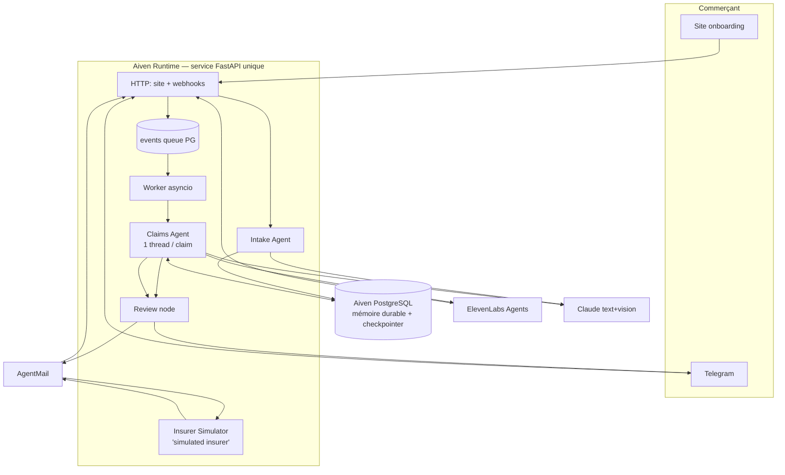

# PRD — Robin : agent autonome de dossier de sinistre pour petites entreprises

| Champ | Valeur |
|---|---|
| Statut | Draft v1 — à approuver par l'équipe |
| Priorité | P0 |
| Date | 2026-10-22 |
| Horizons | **H0** = démo hackathon (aujourd'hui, 16 h) · **H1** = premiers utilisateurs réels (4–8 semaines) · **H2** = produit lancé (3–6 mois) |
| Sources consolidées | `CONTEXTE_PROJET_ASSURANCE.md` §1–14 · `data/research/08a–08d` · `data/research/09a–09c` · corpus `data/contrats/txt/` (12 CG) |
| Référence en cas de conflit | Ce PRD > `CONTEXTE` §14 > reste du `CONTEXTE` |

> **Principe directeur (décision Mathis, 22/10)** : Robin est une **couche procédurale pure**. Il simplifie le processus et fait ce que le commerçant devrait faire lui-même : déclarer, collecter, transmettre, relancer, documenter, expliquer factuellement. Il **n'exécute pas le remboursement**, **ne décide aucun montant**, **ne conseille pas**. Il supprime la friction. Tout ce qui suit découle de ce principe.

---

## 0. Ce qui n'existe pas encore (greenfield)

Aucun code produit dans le dépôt. Ce PRD crée tout. Dépendances externes dont l'état est connu au moment de l'écriture :

- **Aiven** : projet `larp`, PostgreSQL `pg-3f9bc500` en route ; Runtime disponible ; **lien GitHub → Runtime non fait** (admin d'organisation requis). Bloquant H0.
- **Telegram** : bot à créer via @BotFather (2 min). Non bloquant.
- **AgentMail** : offre gratuite 3 boîtes / 100 mails/jour. Suffisant H0, insuffisant H1.
- **ElevenLabs** : crédits Builders Pack à confirmer ; Twilio trial pour un numéro vérifié. Dégradable en widget web.
- **Claude** : clé API à placer en secret Runtime.

---

## 1. Problème, cible, succès

### 1.1. Problème

Après un sinistre, un petit commerçant français doit en 2 jours ouvrés déclarer, déposer plainte, poser une clôture provisoire, puis constituer un état des pertes en lisant 70 à 120 pages de conditions générales qu'il n'a jamais ouvertes. Il ne sait pas ce qui est réclamable : chaque contrat contient **10 à 20 postes annexes** (gardiennage, déblais, honoraires, perte d'usage, tags, serrures, rachat de vétusté, pertes indirectes 10 %) que personne ne lui signale (`08b` §5). Il déclare de mémoire, oublie la perte d'exploitation (seulement 53 % des commerçants la connaissent, `08c` §1.2), chiffre son stock au prix de vente et s'expose à la déchéance totale pour fausse déclaration (Cass. 2e civ., 12/02/2026, `09a` §5). Puis il attend : il n'existe **aucun délai légal de règlement** en MRP (`08d` §1, LMA 2023), personne ne relance, et il signe la première quittance.

Résultat documenté : un buraliste à 200 000 € de dégâts a reçu 55 000 € en 2023 (`08c` §1.2) ; les experts d'assurés revendiquent +15 à +40 % par rapport à l'offre initiale (`08c` §3) ; ~40 % des sinistres immobiliers UK sont ajustés à la baisse pour sous-assurance (Aviva, `09a` §1). Les refus arrivent « en choc » parce que l'assuré ignorait les conditions de sa police (FCA, `09b` §6).

### 1.2. Pourquoi maintenant

- **17–18 octobre 2026** : ~3 000 commerces dégradés, 1–1,2 Md€ de dommages assurés, 70 % de petits commerçants ; délai de déclaration porté à 30 jours par France Assureurs (`08c` §0). Fenêtre d'action ouverte jusqu'à mi-novembre.
- **Pas de filet public** : la garantie émeutes obligatoire (LFI 2026, art. 171) est votée mais **non en vigueur** (`08c` §5).
- **Catégorie validée aux US** : Finch (4,5 M$, 09/2026, Aglaé Ventures au capital), Tugboat (3 M$, 06/2026). **Aucun outil IA côté assuré en France ou en Europe** (`08d` §4).
- Hackathon Accel/Aiven aujourd'hui : déploiement Runtime exigé, preuve mesurée exigée.

### 1.3. Qui

| Persona | Douleur | Ce que Robin enlève |
|---|---|---|
| **Dirigeant de TPE commerce** (cible H0/H1 : commerçant pillé, 17/10) | Pas le temps, pas les compétences, panique ; déclare tard et incomplet | Déclaration J0, collecte guidée, état des pertes complet et cité, relances |
| Dirigeant TPE, sinistre courant (H2 : 110 sinistres / 1 000 contrats / an) | Bris de vitrine, dégât des eaux, vol simple ; dossier « petit » mais chronophage | Même pipeline ; valeur = temps |
| Expert-comptable du commerçant (canal H1) | Sollicité pour la PE sans cadre | Reçoit la demande de pièces structurée (liasses N-1/N-2, CA mensuel) |
| Jury hackathon (H0) | Veut voir des données qui changent des décisions | Doublon refusé, avenant qui change un plafond, reprise après redémarrage, réponse orale non confirmée |

### 1.4. Métriques de succès

| Métrique | Référence (naïf) | Cible | Méthode |
|---|---|---|---|
| **Rappel des postes réclamables** (clause + page correctes) | Déclaration naïve : 3–5 postes / cas | ≥ 90 % des postes de la vérité terrain `08c` §6 | `bench/` sur cas A/B/C × contrat |
| **Citations correctes** (page existe et dit ce qui est affirmé) | LLM seul : citations inventées | ≥ 95 % | Vérification automatique page/texte + relecture |
| **€ identifiés** | A : 38 100 € / B : 20 900 € / C : gonflé 135 100 € | A : ≈ 89 700 € / B : ≈ 57 900 € / C : ≈ 127 200 € **sans un seul montant non sourcé** | `bench/` 3 variantes |
| **Montants non traçables émis par l'agent** | — | **0** | Review node, test AC-12 |
| **Échéances manquées** sur dossier simulé 24 mois | — | 0 | Test de la machine à deadlines |
| **Doublons comptés** | — | 0 | AC-5 |
| **Coût / dossier** (tokens) et latence par événement | — | mesuré, affiché | Logs `actions` |
| H1 : temps commerçant par dossier | non mesuré | mesuré sur 5 dossiers réels | Journal d'actions |
| H1 : satisfaction / NPS 5 premiers clients | — | collecté | Entretien |

---

## 2. Fonctionnalités

Les sous-fonctionnalités complexes suivent le format 7 parties (but, sources, étapes, prompt, schéma, mode d'échec, consommateurs).

### 2.1. Onboarding web (Bloc 1)

**But** : créer l'identité durable, le profil, le mandat et la mémoire initiale, puis relier Telegram.

**Étapes** (`CONTEXTE` §3, §14.7) :
1. Compte (email + mot de passe) ; reprise d'onboarding interrompu.
2. Commerce : nom, SIRET, adresse, dirigeant, téléphone, assureur, courtier, statut locataire/propriétaire, assujettissement TVA (impacte le chiffrage HT/TTC — MAAF p. 80).
3. Upload : CG, CP, avenants, IPID, constats, échanges. Originaux conservés.
4. **Mandat + consentements séparés** (3 cases distinctes : mandat de représentation, canal Telegram, traitement des données). Version, périmètre, signataire, qualité, horodatage, preuve. Le mandat couvre : obtenir des documents, transmettre faits confirmés et pièces, contacter assureur/courtier/expert, demander un statut, relancer. Il **exclut** : accepter une offre, transiger, renoncer, encaisser.
5. Déclenchement de l'Intake Agent → profil de garanties affiché avec pages.
6. Deep link Telegram → `/start` lie le `chat_id` au compte → message de bienvenue en anglais avec résumé du contrat.

**Règles** : un compte peut être créé avec un profil incomplet ; **un sinistre urgent ne doit jamais attendre la fin de l'onboarding** (ouvrir le dossier, déclarer, compléter ensuite). Statuts distincts : compte créé / profil partiel / mandat enregistré / Telegram relié / bienvenue envoyée-livrée-échouée.

**Mode d'échec** : échec d'envoi Telegram → compte reste créé, site propose « reprendre », aucun faux succès.

### 2.2. Intake Agent — profil de garanties

**But** : transformer les PDF du client en mémoire structurée, clause par clause, avec page et confiance.

**Sources** : documents uploadés ; corpus `data/contrats/txt/` pour pré-remplir si la CG est reconnue (hash / référence éditeur, ex. « 11031 - 01/26 » MAAF).

**Étapes** :
1. Classer chaque document : `CG | CP | avenant | IPID | constat | plainte | échange | facture | autre`, avec date du document et période de validité.
2. Découper en clauses paginées (`\f` de `pdftotext -layout`), indexer `tsvector` (dictionnaire `french`).
3. Extraire le **profil de garanties** : pour chaque garantie candidate (incendie-vandalisme, émeutes, vol, bris de glace, PE, biens confiés, frais annexes…) → `souscrite: oui|non|inconnu`, plafond, franchise, conditions (protections exigées, accord préalable), exclusions notables, `clause_id` source, confiance.
4. Extraire la **machine à deadlines** du contrat (voir 2.5) : délai déclaration vol / autre, délai plainte (24 h Generali/Allianz, 48 h AXA, « au plus vite » MAAF), état des pertes (30 j MMA), rachat de vétusté (2 ans), paiement après accord (30 j).
5. Extraire les **leviers contractuels** : renonciation à la règle proportionnelle (oui chez Generali p. 54, AXA p. 55, Allianz p. 57, MAAF p. 78, MMA p. 85, Hiscox p. 32), garantie honoraires d'expert (MMA 10 % max 40 k€ ; Generali 5 % ; Hiscox 5 % ; **absente** MAAF, AXA Mon Pack), franchise unique si garanties cumulées (MAAF p. 80, Generali p. 54), pertes indirectes 10 %, acomptes PE (Generali p. 52), avance 50 % (Allianz p. 61).
6. Détecter les **pièges contractuels** (`09a`, `08a` §pièges) : exclusion vol pendant émeutes (Sogessur p. 19), vol exclu de la garantie émeutes → ventiler (AXA p. 7), PE impossibilité d'accès exclue (AXA p. 29, MAAF p. 43), assistance exclue en émeutes (Generali p. 60), réparations sans accord écrit interdites (Generali p. 45), stock plafonné 3 000 € sans DP (Allianz p. 66).
7. Lister les **documents manquants** comme tâches (CP absentes → « Could you upload the policy schedule showing your selected cover? »). **Ne jamais déduire qu'une option n'est pas souscrite parce que sa page manque.**

**Prompt (extraction, par clause candidate)** :
```
You are extracting insurance coverage facts from a French commercial property policy.
Document: {doc_type} "{doc_title}", page {page}.
Clause text (verbatim, French): """{clause_text}"""
Task: for the guarantee "{guarantee_name}", return ONLY what this clause states. Do not infer
from other pages. If the clause does not address the field, return null.
Return JSON matching the schema. Keep `quote` as an exact short verbatim excerpt (≤ 200 chars).
```

**Schéma de sortie** :
```json
{
  "guarantee": "string — canonical key, e.g. theft, riot, glass, business_interruption",
  "subscribed": "yes | no | unknown",
  "ceiling": {"amount": "number|null", "unit": "EUR|percent_of_content|days", "basis": "string|null"},
  "deductible": {"amount": "number|null", "unit": "EUR|days|percent"},
  "conditions": ["string"],
  "exclusions": ["string"],
  "quote": "string — verbatim excerpt",
  "clause_id": "uuid",
  "page": "int",
  "confidence": "high | medium | low"
}
```

**Mode d'échec** : OCR illisible → document marqué `unreadable`, tâche « please re-upload page X » ; extraction `low` confidence → champ affiché avec badge « to confirm », jamais utilisé dans un envoi à l'assureur sans confirmation du commerçant.

**Consommateurs** : Claims Agent (`load_memory`, `analyze`), machine à deadlines, UI profil de garanties, benchmark (vérité terrain = `08a/08b`).

### 2.3. Claims Agent — boucle principale (Bloc 2)

**But** : un thread LangGraph par dossier qui fait avancer le sinistre de la déclaration à la présentation de l'offre, en autonomie, et ne rend la main qu'aux moments définis.

**Nœuds** (alignés `CONTEXTE` §14.3, enrichis) :

| Nœud | Rôle | Enrichissement issu de la recherche |
|---|---|---|
| `load_memory` | Charge entreprise, profil de garanties, dossier, faits, pièces, état des pertes, actions, échanges, deadlines | — |
| `triage` | Qualifie l'événement entrant ; décide répondre / mettre à jour / agir / attendre | **Urgence J0** : si nouveau sinistre → déclencher immédiatement `declare_initial` sans attendre les pièces (L113-2 ; 2 j ouvrés vol) |
| `analyze` | Met à jour faits + état des pertes (poste = preuve + clause + calcul + condition) ; dédoublonne ; signale contradictions et manques | **Ventilation** par garantie (vol vs dégâts vs PE) ; **qualification factuelle** du sinistre sans mots interdits ; détection sous-assurance et clauses dérogatoires ; **chaîne causale** dommage matériel → PE |
| `act` | Exécute les outils | — |
| `review` | Contrôle avant tout envoi | Voir 2.7 — **gate juridique + preuve + chiffres** |
| `wait` | `interrupt()` typé | `awaiting_client`, `awaiting_insurer_email`, `awaiting_call_result`, `awaiting_followup`, `awaiting_signature_decision` |
| `present_offer` | Fin de boucle | Comparaison chiffrée poste par poste, **détection quittance/transaction**, décision du commerçant |

**Outils** (`@tool`, chacun écrit dans `actions`) :
`get_claim_memory`, `search_clauses(contract_id, query)`, `read_document(doc_id)`, `update_loss_statement(items)`, `ask_client(text, requested_items)`, `send_email(to, subject, body, attachment_ids)`, `start_call(goal, questions)`, `schedule_followup(when, reason)`, `log_fact(fact, source, confidence)`, `register_deadline(kind, due_at, source_clause_id)`, `present_offer(offer_id)`, `request_insurer_document(kind)` (CG/CP signées + preuve de remise, rapport d'expert — `08c` §4.7).

**Parcours opérationnel** (`CONTEXTE` §4) enrichi :
1. Identifier le sinistre, les urgences ; **checklist J0** générée depuis le contrat : plainte (délai contractuel), clôture provisoire (obligation MAAF p. 14/18 — et facturable 6 600 €), photos avant travaux, pas de réparation sans accord écrit sauf conservatoire.
2. **Déclaration initiale par mail à J0** avec les faits confirmés uniquement ; accusé conservé.
3. Lire le jeu contractuel à la date du sinistre (avenant applicable) → garanties candidates.
4. Construire l'état des pertes vivant ; **« sous réserve de compléments »** systématique (`09b` §5).
5. Demander les pièces manquantes (client / expert-comptable pour la PE : liasses N-1, N-2, CA mensuel, charges variables) ; mail/appel à l'assureur pour une question précise.
6. Transmettre les compléments ; suivre l'expertise (2.8).
7. Présenter l'offre (2.9).
8. Suivre acomptes, paiement, **complément valeur à neuf à 2 ans**, et **recours État** en parallèle (2.10).

### 2.4. État des pertes vivant

**But** : le cœur du produit. Chaque poste relie dommage → preuve(s) → clause (page) → calcul → condition → statut.

**Catalogue de postes** (extrait de `08b` §5 et `08c` §3.2 — l'agent parcourt ce catalogue pour chaque dossier et vérifie l'applicabilité au contrat) :
stock (prix d'achat du jour + transport/manutention/taxes non récupérables), pièces/accessoires, **biens confiés** (appareils clients), vitrine (sans vétusté chez AXA p. 56) + vitrophanie/lettrage, rideau métallique, enseigne/store/banne, serrures (MAAF 3 000 €), agencements et embellissements du locataire, matériel (valeur à neuf si < 2/3/5 ans selon contrat), **gardiennage/clôture** (MAAF 6 600 €, Generali 14 000 €), déblais/nettoyage/décontamination, **tags**, espèces (MAAF 10 % contenu max 16 000 €), reconstitution archives, garde-meuble/déplacement, relogement/local provisoire, honoraires architecte/décorateur, mise en conformité, **pertes indirectes 10 %**, **PE (marge brute, période, franchise jours, acomptes)**, frais supplémentaires d'exploitation (accord préalable), scellés prolongeant la PE (AXA p. 28), perte de valeur vénale du fonds, leasing restant dû, honoraires d'expert d'assuré (si garanti), **rachat de vétusté différé**, **reliquat réclamable à l'État**.

**Règles de calcul** : HT si assujetti TVA ; une seule franchise si clause « franchise unique » ; vétusté selon formule contractuelle (jamais inventée) ; PE = perte de CA × taux de marge brute − charges économisées + frais supplémentaires, avec N-1 et N-2 (TJ Saint-Étienne 2025 : une baisse qui suit la tendance antérieure est rejetée) ; **aides publiques de nature différente non déductibles** de la PE (TAE Marseille 29/01/2026) mais activité partielle déductible.

**Schéma `loss_items`** : voir §3.4.

**Mode d'échec** : poste sans preuve → `status = unsupported`, exclu de tout envoi, tâche de collecte ; poste sans clause → `status = no_cover_found`, visible au commerçant, candidat au recours État.

### 2.5. Machine à deadlines

**But** : zéro échéance manquée. Toutes les dates sont des tâches persistées (`scheduled_tasks`) issues du contrat ou de la loi, avec la clause source.

| Échéance | Source | Comportement |
|---|---|---|
| Plainte | 24 h (Generali p. 45, Allianz p. 56) / 48 h (AXA p. 54) / « au plus vite » (MAAF p. 76) | Tâche J0, rappel client |
| Déclaration vol/vandalisme | 2 j ouvrés (L113-2 ; tous les contrats) ; **30 j** pour le 17/10 (France Assureurs) | Déclaration envoyée J0 quoi qu'il arrive |
| Déclaration autre | 5 j ouvrés | idem |
| État des pertes | 30 j (MMA p. 81), « dès que possible » (MAAF) | Relance interne ; envoi « sous réserve » |
| Aggravation de risque | 15 j LRAR (L113-2 3°) | Déclenché par changement d'activité détecté |
| Réponse à l'assureur | Chaque demande de l'assureur loguée avec due date le jour de réception | Relance client J-2 |
| Relance assureur | Fixée à l'envoi de chaque demande (J+7 par défaut) | relance → LRAR → réclamation → médiation (si éligible) |
| Réclamation → médiation | 2 mois sans réponse | Information factuelle au commerçant |
| Paiement après accord | 30 j (Generali p. 54, MMA p. 92) | Relance |
| **Rachat de vétusté** | 2 ans (tous) | Tâche J+700, factures de remplacement |
| Prescription assureur | 2 ans (L114-1) ; interrompue par LRAR règlement / désignation expert (L114-2) | Alerte J-90 ; vérifier rappel au contrat (R112-1) sinon inopposable |
| **Recours État** | 4 ans → **31/12/2030** pour le 17/10 (L211-10 CSI, demande préalable préfet R421-1 CJA) | Tâche long terme |

**Mode d'échec** : si une échéance est passée → marquer `missed`, informer factuellement (« the contractual deadline for X was DATE; late declaration can only be opposed if the insurer proves prejudice — L113-2 »), continuer.

### 2.6. Discipline de preuve et provenance

- Chaque `fact` porte `source` (document / client / oral assureur / mail assureur), `confidence`, `status` (`confirmed | to_confirm | contradicted`), `supersedes`.
- **Réponse orale ≠ contrat** : une réponse d'appel est stockée `source=oral, status=to_confirm` et déclenche une demande de confirmation écrite ; elle ne modifie jamais le profil de garanties.
- **Doublons** : hash fichier + (montant, date, fournisseur) → `duplicate_of` ; l'agent le dit au commerçant.
- **Correction** : nouvelle version, jamais d'écrasement.
- **Préservation des preuves** : rappel J0 « photos avant travaux ; keep all invoices » (LMA 2020 cas 1.11 : des travaux avant expertise font refuser la couverture).

### 2.7. Review node — le gate avant tout envoi

**But** : rien ne sort sans passer ces contrôles. C'est la protection du commerçant **et** la protection juridique du service (`09c`).

| Contrôle | Règle | Échec → |
|---|---|---|
| Preuve | chaque poste envoyé a ≥ 1 `evidence` et 1 `clause_id` existant | retour `analyze` |
| Citation | la page citée contient le texte affirmé (match verbatim du `quote`) | retour `analyze` |
| Doublon | aucun `evidence.duplicate_of` compté | retour `analyze` |
| **Montant traçable** | **tout € émis provient d'une `evidence` ou d'une instruction explicite du commerçant (`facts.source = client_instruction`)** — jamais de l'agent | bloqué |
| **Aucune promesse / acceptation** | regex + LLM : pas de « we accept », « agreed », « waive », « final » | bloqué |
| **Aucun avis juridique personnalisé** | pas de « you should », « we recommend accepting/refusing », « your chances », « legally insufficient » ; autorisé : constats factuels, citations, écarts chiffrés, énoncé des voies génériques | réécriture |
| **Mots interdits** (recours État, `08c` §4.3) | « organisé(s) », « bande », « venus exprès », « casseurs », « émeutiers », « prémédité » dans tout texte vers assureur / plainte / préfet | réécriture en faits (heure, lieu, nombre, lien au cortège) |
| Fait non confirmé | aucun `fact.status != confirmed` dans un envoi externe | retrait ou question au client |
| Langue | anglais vers le commerçant ; **français vers assureur français** (décision à prendre, cf. Q4) | — |

**Prompt (review)** :
```
You are the compliance reviewer for outbound messages of a claims-handling assistant in France.
The assistant is a PURE PROCEDURAL LAYER: it transmits documented facts and amounts, cites policy
clauses, asks for documents, follows up. It must NEVER: state an amount not present in the evidence
list; accept, agree, waive or settle anything; give personalised legal advice or recommendations;
use the words {banned_words} when describing the event.
Message: """{draft}"""
Evidence amounts: {evidence_amounts}
Client instructions: {client_instructions}
Return JSON: {"pass": bool, "violations": [{"type": "...", "span": "...", "fix": "..."}], "rewrite": "string|null"}
```

### 2.8. Gestion de l'expertise

- Demander par écrit : rapport de l'expert de l'assureur, CG/CP **signées** + preuve de remise avant d'accepter une exclusion (`08c` §4.7).
- Avant la visite : remettre à l'expert le dossier écrit (état des pertes, photos indexées, factures) — traçable ; après : envoyer les observations écrites immédiatement (pas de contre-signature en droit, `09b` §3).
- Extraire du contrat l'existence et le plafond de la garantie « honoraires d'expert » et **l'afficher factuellement** au commerçant (« your policy covers an assessor of your choice up to 10 % / 40 000 € — MMA p. 69 ») ; la décision de mandater un expert d'assuré lui appartient. Robin ne recommande pas, il informe.
- La désignation d'un expert interrompt la prescription → enregistrer la date.

### 2.9. Présentation de l'offre et gate signature

**But** : le commerçant décide en connaissance de cause ; Robin compare et explique, ne recommande pas.

**Étapes** :
1. Rapprochement poste par poste : `covered | partial | refused | absent` ; paramètres appliqués (vétusté vs formule contractuelle, plafond, franchise — une seule ?, règle proportionnelle — renoncée au contrat ?).
2. Caractère : acompte / provisionnel / définitif ; document joint ?
3. **Détection** dans tout document assureur : « quittance », « solde de tout compte », « renonciation », « transaction », « définitif », « pour solde » → `awaiting_signature_decision` avec explication factuelle de l'effet (« this document extinguishes further claims on this loss — art. 2052 C. civ.; there is no 15-day withdrawal for property claims »).
4. Restitution : « The offer covers X € of the Y € documented in your loss statement (Z %). Not covered: [items]. Applied: 30 % depreciation on shutter (policy formula: p. 79); theft ceiling 15 000 € applied to stock (your schedule shows a riot extension — p. CP). You can: accept, ask for details, contest. » Puis liste des voies génériques (réclamation écrite, médiation si éligible, expert d'assuré, avocat) **sans pondération**.
5. Décision du commerçant → `accept` (suivi paiement + vétusté) / `contest` (il indique les postes et le chiffre ; Robin transmet) / `ask`.

**Règle absolue** : absence de réponse ≠ acceptation.

### 2.10. Module « recours État » (L211-10 CSI) — H1

**But** : le reliquat non payé par l'assureur (franchise, vétusté, plafonds, PE non garantie) est réclamable à l'État pour les dégâts d'attroupements — poste **presque toujours oublié** (`08c` §3.2 n° 9).

- Déclenché si le sinistre est daté d'un événement d'attroupement connu (table `riot_events` : 17–18/10/2026…).
- Constitue la **demande préalable chiffrée au préfet** (R421-1 CJA) avec le même état des pertes, le décompte assureur, et une description factuelle horodatée **sans mots interdits**.
- Suit la prescription quadriennale (31/12/2030).
- Mode d'échec : si les faits décrits par le client contiennent « organisés / équipés » → Robin reformule en faits bruts et demande confirmation ; ne qualifie jamais.

### 2.11. Insurer Simulator Agent (H0)

Graphe séparé, boîte AgentMail dédiée, **étiqueté « simulated insurer »** dans l'UI et le pitch. Script paramétrable par scénario : accusé → demande de pièces (plainte, nombre d'appareils clients) → offre plafonnée (≈ 20 750 € pour Karim) → relance tardive → **quittance pour solde de tout compte** jointe à l'offre (pour déclencher le gate signature en démo). Ne voit jamais la mémoire du Claims Agent.

### 2.12. Benchmark (H0, slide de preuve)

Script `bench/` sur cas A/B/C de `08c` §6 × contrat (A : MAAF 11031 + CP synthétiques ; B/C : à affecter — AXA Atouts PME, Generali 100% Pro). Trois variantes : déclaration naïve, LLM seul (même modèle, même récit, sans clauses ni factures), Claims Agent. Mesures : € identifiés, rappel des postes, % citations correctes, montants non traçables (doit être 0), coût tokens, latence. Vérité terrain : `08a/08b` (clauses + pages), `08c` §6 (postes). **Aucun chiffre affiché avant d'avoir été mesuré.** Le temps manuel chronométré est retiré du benchmark H0 (infaisable honnêtement en une journée).

### 2.13. Workflows utilisateur

**W1 — Nouveau sinistre (Karim)**
1. Telegram : « My shop was looted Saturday night » + 3 photos + 2 factures.
2. `triage` → nouveau dossier → checklist J0 (plainte, clôture, photos avant travaux) → **déclaration initiale envoyée J0** → accusé.
3. `analyze` : faits extraits (vision), postes initiaux, garanties candidates (émeutes incluse MAAF p. 15 ; vol/vandalisme = option → CP), pièces manquantes → `ask_client`.
4a. Karim renvoie une facture déjà envoyée → doublon détecté, dit.
4b. Karim envoie l'inventaire → postes mis à jour, état des pertes transmis « sous réserve de compléments ».
5. Assureur simulé demande la plainte → relayé → reçu → transmis.
6. Appel ElevenLabs : « Does the riot extension apply to stock, or the €15 000 theft cap? » → réponse orale `to_confirm` → mail de confirmation écrite demandé.
7. Offre ≈ 20 750 € + quittance → `present_offer` → gate signature → Karim décide.
8. Si `contest` : Karim indique postes et chiffres ; Robin transmet la contestation chiffrée et sourcée. Si `accept` : suivi paiement 30 j, tâche vétusté J+700, module État.

**W2 — Reprise après redémarrage** : service relancé pendant la démo → thread repris depuis le checkpointer → même état, mêmes tâches.

**W3 — Avenant ajouté** : nouvelle CP avec plafond vol 30 000 € → Intake re-tourne → profil versionné → `analyze` recalcule → delta visible.

### 2.14. Cas limites

| # | Cas | Comportement |
|---|---|---|
| 1 | CP absentes | Garanties `unknown`, jamais `non` ; tâche d'upload ; `request_insurer_document(CP)` |
| 2 | Sinistre pendant délai de carence | Détecté depuis CP ; dit factuellement ; pivot recours alternatifs |
| 3 | Prime impayée / suspension L113-3 | Question J0 + demande d'attestation ; aucun envoi tant qu'inconnu |
| 4 | Client déclare le stock au prix de vente | Robin recale au prix d'achat **avec la clause** (MAAF p. 79) et explique le risque factuel (déchéance pour fausse déclaration) ; n'envoie pas le chiffre gonflé |
| 5 | Client écrit « casseurs organisés » | Reformulation factuelle proposée ; confirmation avant envoi |
| 6 | Contradiction facture / inventaire | Les deux faits `contradicted` ; question ciblée ; aucun n'est envoyé |
| 7 | Réponse orale contredit le contrat | Stockée `to_confirm` ; profil inchangé ; confirmation écrite demandée |
| 8 | Deux contrats sur le même risque | L121-4 : déclaration croisée ; répartition par poste ; total ≤ dommage |
| 9 | Locataire + incendie | Art. 1733 C. civ. : documenter l'origine extérieure (horodatage, vidéo) ; deux flux (bailleur / MRP) |
| 10 | Assureur silencieux 60 j | relance → LRAR (interrompt prescription) → réclamation → info médiation |
| 11 | Commerçant ne répond pas à l'offre | Rappel J+3, J+7 ; jamais d'acceptation implicite |
| 12 | Document assureur contient « solde de tout compte » caché dans un « accusé de règlement » | Détection → gate signature |
| 13 | Message hors périmètre (« should I sue? ») | Réponse documentaire : voies existantes, pas d'avis ; orientation avocat/expert d'assuré comme option |
| 14 | Mandat révoqué | Toutes les tâches suspendues ; aucun envoi ; dossier exportable |

### 2.15. Hors périmètre

- **PAS de recommandation** accepter/refuser, pas d'évaluation de « chances », pas de négociation en nom propre (Cass. 2e civ. 9/12/2015 ; CA Nîmes 7/07/2023 ; Cass. 2e civ. 7/05/2025 — `09c` §1.2, `08d` §3).
- **PAS d'encaissement** des fonds ; l'assureur paie le commerçant.
- **PAS de vente ou recommandation de contrat** (bascule ORIAS, L511-1).
- PAS d'accès aux espaces clients assureurs (non vérifié techniquement, `CONTEXTE` §2).
- PAS de WhatsApp en H0 (Telegram) ; WhatsApp en H1 après validation Meta.
- PAS de démarchage terrain (risque « vautours », préfecture Gironde 2023).
- PAS d'équipe humaine cachée ; les professionnels (expert d'assuré, avocat) sont **présentés comme options** au commerçant, jamais mobilisés en coulisses.

---

## 3. Architecture

### 3.1. Vue d'ensemble



### 3.2. Composants

| Composant | Responsabilité | H0 | H1+ |
|---|---|---|---|
| `app/web` | Onboarding 6 étapes, mandat, consentements, profil de garanties, page de suivi par lien | Minimal (peut être 1 page) | Complet |
| `app/channels/telegram` | Long polling dev / webhook prod ; médias via `getFile` ; vocaux → transcription | Oui | + WhatsApp |
| `app/channels/email` | AgentMail : 1 boîte / compte ; webhook entrant → `events` | Oui | Domaine propre, volume |
| `app/channels/voice` | ElevenLabs : appel sortant, variables dynamiques, post-call webhook | Dégradable widget | Twilio prod |
| `app/agents/intake` | 2.2 | Oui | — |
| `app/agents/claims` | 2.3–2.9 | Cœur | + 2.10 |
| `app/agents/review` | 2.7 | Oui | + eval continue |
| `app/agents/insurer_sim` | 2.11 | Oui | Retiré en prod réelle |
| `app/deadlines` | 2.5 scheduler | Oui | — |
| `app/ingestion` | pdftotext → clauses → tsvector | Oui | pgvector si utile |
| `bench/` | 2.12 | Oui | CI nightly |
| `migrations/` | Alembic au démarrage | Oui | — |

### 3.3. Décisions techniques

| Décision | Options | Choix | Pourquoi |
|---|---|---|---|
| Canal | WhatsApp Cloud / Telegram | **Telegram** (H0) | Token immédiat, pas de fenêtre 24 h ; WhatsApp H1 |
| Framework agent | ReAct générique / LangGraph explicite | **LangGraph** | Checkpointer PG, `interrupt()` natif pour les attentes longues |
| Topologie | 1 service / 2 services | **1 service** | 1 Dockerfile, tout l'état en base |
| Recherche clauses | tsvector / pgvector | **tsvector `french`** | 12 contrats ; pgvector optionnel |
| LLM | Claude | **Claude** | Vision factures/PV ; sorties structurées |
| Stockage docs | bytea / objet | **bytea** H0 | Prototype ; objet S3-compatible H1 |
| Langue bot | EN / FR | **EN vers commerçant** (décision Mathis) ; **FR vers assureur** à trancher (Q4) | Jury anglophone ; assureur français réel |
| Signature mandat | case + nom + horodatage / eIDAS | **case + horodatage** H0 ; eIDAS H1 | — |
| Humain dans la boucle | oui / non | **Non** (décision Mathis) ; professionnels = options présentées | Autonomie + périmètre légal |

### 3.4. Modèle de données (Aiven PostgreSQL)

Toutes les tables : `id uuid pk`, `account_id uuid not null` (isolement), `created_at timestamptz default now()`.

```sql
-- Identité & mandat
create table accounts (email text unique not null, password_hash text not null);
create table businesses (name text, siret text, address text, manager_name text, phone text,
  insurer text, broker text, tenant_or_owner text check (tenant_or_owner in ('tenant','owner','unknown')),
  vat_registered boolean);                                   -- null = inconnu (3 états)
create table mandates (version int, scope jsonb, signer_name text, signer_role text,
  accepted_at timestamptz, proof jsonb, revoked_at timestamptz);
create table consents (kind text check (kind in ('mandate','channel','data')), accepted_at timestamptz, version text);
create table mailboxes (address text unique, provider_id text, role text check (role in ('agent','simulated_insurer')));
create table telegram_links (chat_id bigint unique, state text, linked_at timestamptz);
create table link_codes (code text unique, expires_at timestamptz, used_at timestamptz);

-- Documents & contrat
create table documents (doc_type text, origin text, version text, doc_date date, valid_from date, valid_to date,
  sha256 text, content bytea, extracted_text text, readable boolean);
create table clauses (document_id uuid references documents, page int, title text, body text,
  tsv tsvector generated always as (to_tsvector('french', coalesce(title,'')||' '||body)) stored);
create index clauses_tsv on clauses using gin(tsv);
create table coverage_profile (version int, guarantee text, subscribed text check (subscribed in ('yes','no','unknown')),
  ceiling jsonb, deductible jsonb, conditions jsonb, exclusions jsonb, quote text,
  clause_id uuid references clauses, page int, confidence text, supersedes uuid);
create table contract_levers (kind text, present boolean, detail jsonb, clause_id uuid references clauses);
  -- kind: no_proportional_rule | assessor_fees | single_deductible | indirect_losses_10pct | bi_advances | traps.*

-- Sinistre
create table claims (status text, loss_date timestamptz, nature text, summary text, riot_event_id uuid);
create table facts (claim_id uuid references claims, text text, source text
  check (source in ('document','client','client_instruction','insurer_email','insurer_oral','agent_inference')),
  confidence text, status text check (status in ('confirmed','to_confirm','contradicted','superseded')), supersedes uuid);
create table evidence (claim_id uuid, document_id uuid references documents, kind text, amount numeric, currency text default 'EUR',
  evidence_date date, supplier text, sha256 text, duplicate_of uuid references evidence);
create table loss_items (claim_id uuid, category text, label text, amount_claimed numeric, amount_basis text,
  evidence_ids uuid[], clause_id uuid references clauses, computation jsonb, condition text,
  status text check (status in ('supported','unsupported','no_cover_found','sent','accepted','refused','partial')),
  version int, supersedes uuid);
create table communications (claim_id uuid, channel text, direction text, counterpart text, subject text, body text,
  attachments uuid[], provider_message_id text, delivered boolean, failed_reason text, insurer_position_verbatim text);
create table calls (claim_id uuid, goal text, questions jsonb, transcript text, structured_result jsonb, confidence text);
create table actions (claim_id uuid, tool text, args jsonb, result jsonb, trigger_event_id uuid, tokens_in int, tokens_out int, latency_ms int);
create table scheduled_tasks (claim_id uuid, kind text, due_at timestamptz, reason text, source_clause_id uuid,
  state text check (state in ('pending','done','missed','cancelled')));
create table offers (claim_id uuid, received_at timestamptz, items jsonb, total numeric, nature text
  check (nature in ('advance','provisional','final')), has_release_language boolean, release_terms text,
  comparison jsonb, client_decision text check (client_decision in ('accept','contest','ask')), decided_at timestamptz);
create table payments (claim_id uuid, offer_id uuid, amount numeric, received_at timestamptz, kind text);
create table riot_events (name text, started_at timestamptz, ended_at timestamptz, cities text[], state_claim_deadline date);

-- File d'événements & review
create table events (source text, payload jsonb, state text check (state in ('pending','processing','done','failed')),
  claim_id uuid, attempts int default 0);
create table review_log (claim_id uuid, draft text, passed boolean, violations jsonb, rewrite text);
-- + tables du checkpointer LangGraph (créées par la librairie)
```

### 3.5. Flux d'événements

```
Telegram update ─┐
AgentMail webhook ┼─> INSERT events (pending) ─> worker: SELECT … FOR UPDATE SKIP LOCKED
ElevenLabs post-call ┤                                 ├─ thread en attente ? → Command(resume=payload)
scheduler (deadlines) ┘                                └─ sinon → nouveau run
Webhook répond < 1 s. Action marquée faite seulement sur résultat constaté (message_id, accusé, fin d'appel).
```

---

## 4. Dépendances

| Service / paquet | Usage | Risque | Repli |
|---|---|---|---|
| Aiven Runtime + PG | Hébergement, état | **Lien GitHub = bloquant H0** (admin org) | Identifier l'admin dès maintenant ; déployer un hello à 13 h |
| `langgraph`, `langgraph-checkpoint-postgres`, `langchain-anthropic` | Agents | Version Store inter-threads à vérifier | Lecture directe des tables |
| `fastapi`, `uvicorn`, `sqlalchemy`, `alembic`, `psycopg[binary]` | App | Faible | — |
| `python-telegram-bot` | Canal | Faible | — |
| AgentMail API | Mail | 3 boîtes gratuites | 1 Karim + 1 simulateur + 1 réserve |
| ElevenLabs Agents + Twilio trial | Appel | Crédits / numéro vérifié | Widget web projeté |
| Anthropic API | LLM + vision | Coût / latence | Cache des extractions par sha256 |
| `pdftotext` (poppler) | Ingestion | Dans l'image Docker | — |
| ElevenLabs Scribe / Whisper | Vocaux Telegram | Optionnel H0 | Saute (étape 9) |

Ordre : Aiven squelette → ingestion → Claims Agent minimal → Telegram → benchmark → AgentMail + simulateur → site → voix → vocaux (`CONTEXTE` §14.10 ; 1–5 non négociables).

---

## 5. Contrats d'interface

```python
# Événement normalisé (toutes sources)
class InboundEvent(TypedDict):
    source: Literal["telegram","agentmail","elevenlabs","scheduler","web"]
    account_id: str; claim_id: str | None
    kind: Literal["message","document","email","call_result","deadline","onboarding_done"]
    payload: dict; received_at: datetime

# Reprise d'un thread en attente
Command(resume={"wait_type": "awaiting_client", "event": InboundEvent})

# Tool signatures (chaque appel → ligne `actions`)
def search_clauses(contract_id: str, query: str, k: int = 8) -> list[Clause]  # Clause{id,page,title,body}
def read_document(doc_id: str) -> DocExtract  # {doc_type, facts: [...], amounts: [...], confidence}
def update_loss_statement(items: list[LossItemInput]) -> list[LossItem]
def ask_client(text_en: str, requested_items: list[str]) -> CommId
def send_email(to: str, subject: str, body: str, attachment_ids: list[str]) -> CommId  # passe par review
def start_call(goal: str, questions: list[str]) -> CallId
def schedule_followup(when: datetime, reason: str, source_clause_id: str | None) -> TaskId
def register_deadline(kind: str, due_at: datetime, source_clause_id: str | None) -> TaskId
def log_fact(text: str, source: FactSource, confidence: str) -> FactId
def request_insurer_document(kind: Literal["CG_signed","CP_signed","delivery_proof","expert_report"]) -> CommId
def present_offer(offer_id: str) -> None  # interrupt awaiting_signature_decision

# Review
def review(draft: OutboundDraft, ctx: ReviewContext) -> ReviewResult  # {pass, violations[], rewrite}

# HTTP
POST /webhooks/telegram        # secret = token dans l'URL
POST /webhooks/agentmail       # signature vérifiée
POST /webhooks/elevenlabs      # signature vérifiée
POST /onboarding/*             # session cookie
GET  /claims/{id}/track?token= # page de suivi par lien (lecture seule)
GET  /healthz
```

---

## 6. Questions ouvertes et spikes

| # | Question | Hypothèse actuelle | Spike | Bloque |
|---|---|---|---|---|
| Q1 | Qui a le rôle admin d'organisation Aiven ? | Un membre de l'équipe | Demander maintenant ; sinon déployer ailleurs et documenter | H0 déploiement |
| Q2 | Store LangGraph pour mémoire inter-threads ? | Non nécessaire | Vérifier version installée | Non |
| Q3 | Crédits ElevenLabs + numéro Twilio vérifié | Disponibles | Test d'appel à 14 h | Étape 8 |
| Q4 | **Langue des mails/appels vers un assureur français** | EN pour la démo (jury) | Décision Mathis ; recommandation : **FR vers assureur réel en H1**, EN conservé en démo | H1 |
| Q5 | Éligibilité des professionnels à la Médiation de l'Assurance | Incertaine (charte « consommateurs ») | Vérifier par assureur / charte LMA | H1 wording |
| Q6 | **Qualification juridique du service** (loi 1971 / L511-1) avec le périmètre « couche procédurale » | Hors consultation juridique et hors distribution | **Avis d'avocat avant la première facture** | H1 lancement |
| Q7 | Modèle de rémunération compatible avec Q6 | % à l'indemnisation (benchmark 5–10 % experts d'assurés, ~10 % public adjusters) | Avocat : un % sur résultat renforce-t-il la qualification « conseil » ? Alternatives : abonnement, forfait par dossier | H1 |
| Q8 | Numéros de jurisprudence affichés | Issus de sources secondaires | Vérifier sur Légifrance avant tout affichage à l'écran | H0 slide |
| Q9 | Contrats B et C du benchmark | AXA Atouts PME / Generali 100% Pro | Affecter et vérifier les CP synthétiques | H0 bench |
| Q10 | RGPD : DPA, hébergement UE, PV de plainte (données sensibles) | Aiven `fra` = UE | Registre des traitements, DPA fournisseurs | H1 |

---

## 7. Modes d'échec

### 7.1. Risques

| Risque | Prob. | Impact | Mitigation |
|---|---|---|---|
| Lien GitHub Runtime impossible à temps | Moy. | **Critique H0** | Hello world déployé en premier ; plan B hébergement + explication honnête au jury |
| L'agent émet un montant non sourcé ou un avis | Moy. | Critique (juridique + confiance) | Review node bloquant + `review_log` + test AC-12 ; eval sur 50 drafts avant démo |
| Fait non vérifié envoyé → déchéance du client | Faible | Critique | `facts.status` gate ; vision confidence ; question au client |
| Hallucination de clause / page | Moy. | Élevé | Citation vérifiée verbatim contre `clauses.body` |
| Doublon compté | Faible | Moyen | sha256 + triple clé |
| Webhook > 1 s → retry tempête | Moy. | Moyen | Insert + 200 immédiat ; idempotence sur `provider_message_id` |
| Checkpointer incompatible | Faible | Élevé | Test de reprise dès l'étape 3 |
| Coût LLM | Moy. | Moyen | Cache extraction par sha256 ; plafond $/dossier ; modèle plus petit pour triage |
| Démo : assureur simulé perçu comme triche | Moy. | Élevé pitch | Étiquette « simulated insurer » partout ; appel en direct réel |
| Réputation « vautour » | Faible H0 | Élevé H1 | GTM par prescripteurs (experts-comptables, CCI, courtiers), jamais de démarchage |
| Requalification juridique du service | Moy. | **Critique H1** | Q6/Q7 ; périmètre gravé dans le review node et les CGU |

### 7.2. Erreurs côté commerçant (Telegram, EN)

| Erreur | Message | Reprise |
|---|---|---|
| Document illisible | "I couldn't read this file. Could you send a clearer photo of page X?" | Tâche d'upload |
| Envoi mail échoué | "The email to your insurer failed to send (provider error). I'll retry in 10 minutes." | Retry 3× puis alerte |
| Appel non abouti | "I couldn't reach the insurer by phone. I've sent the same questions by email." | Bascule mail |
| Deadline passée | "The contractual deadline for X was DATE. Late declaration can only be opposed if the insurer proves prejudice (art. L113-2). I've sent it now." | Continue |
| Hors périmètre | "I can't advise on that decision. Here are the options that exist: …" | Documentaire |

### 7.3. Rollback

Service unique : `redeploy` du commit précédent via API Aiven ; migrations additives uniquement (jamais de `drop` en H0/H1) ; état des dossiers dans PG, rien dans les logs.

---

## 8. Tests et critères d'acceptation

| # | Given | When | Then | Priorité |
|---|---|---|---|---|
| AC-1 | CG MAAF + CP Karim uploadées | Intake tourne | Profil de garanties avec ≥ 15 garanties, chaque ligne a `clause_id` + page existante ; vol/vandalisme = `yes` (CP), PE = `yes` | Must |
| AC-2 | CP absentes | Intake tourne | Toutes les options = `unknown`, jamais `no` ; tâche « upload CP » | Must |
| AC-3 | Message « looted Saturday night » + photos | triage | Dossier créé ; déclaration initiale envoyée **avant** toute demande de pièce ; accusé logué | Must |
| AC-4 | Facture X envoyée 2× | analyze | 1 seule `evidence` comptée ; `duplicate_of` ; message au client | Must |
| AC-5 | Inventaire + factures + CA N-1/N-2 | analyze | État des pertes ≥ 90 % des postes `08c` §6 cas A ; chaque poste a preuve + clause + page | Must |
| AC-6 | Avenant plafond vol 30 k€ ajouté | Intake + analyze | Profil versionné ; poste stock recalculé ; delta affiché | Must |
| AC-7 | Service redémarré en cours d'attente | event arrive | Thread repris ; aucune action rejouée | Must |
| AC-8 | Réponse orale « riot extension applies » | post-call | Fact `insurer_oral/to_confirm` ; profil inchangé ; mail de confirmation envoyé | Must |
| AC-9 | Offre + document « pour solde de tout compte » | present_offer | `has_release_language = true` ; explication factuelle ; `awaiting_signature_decision` ; aucune acceptation implicite après 7 j | Must |
| AC-10 | Client écrit « casseurs organisés » | review | Reformulation factuelle ; mot absent de tout envoi externe | Must |
| AC-11 | Draft contient « we recommend you refuse » | review | Bloqué, réécrit en comparaison chiffrée | Must |
| AC-12 | Draft contient un € absent des `evidence` et des instructions client | review | **Bloqué** ; `review_log` | Must |
| AC-13 | Client déclare stock au prix de vente | analyze | Recalage prix d'achat avec clause ; explication du risque ; prix de vente non envoyé | Must |
| AC-14 | Dossier simulé 24 mois | scheduler | Tâches : plainte, déclaration, état des pertes, relances, paiement 30 j, vétusté J+700, prescription J-90, État 31/12/2030 — toutes créées, aucune manquée | Should |
| AC-15 | Bench A/B/C | `bench/` | 3 variantes mesurées ; agent > LLM seul > naïf en rappel et €, 0 montant non traçable | Must (slide) |
| AC-16 | Deux comptes de démo | isolation | Aucune fuite inter-`account_id` (requêtes filtrées, tests) | Must |

**Tests unitaires** : dédoublonnage, calcul PE, franchise unique, détection mots interdits, détection quittance, deadline extraction par contrat (12 CG). **Intégration** : webhook → events → resume ; AgentMail aller-retour ; checkpointer reprise. **E2E** : W1, W2, W3.

---

## 9. Sécurité et conformité

| Exigence | Seuil | Raison |
|---|---|---|
| Isolation multi-tenant | `account_id` sur toutes les tables, filtré dans chaque requête ; test AC-16 | Données financières et pénales (PV) |
| Authentification site | Session cookie HttpOnly/SameSite ; mot de passe argon2 | — |
| Liaison Telegram | Code à usage unique, expiré 15 min ; `chat_id` vérifié ; jamais de fusion sur numéro seul | Anti-usurpation |
| Webhooks | Signature AgentMail / ElevenLabs vérifiée ; token Telegram en secret d'URL ; idempotence `provider_message_id` | — |
| Secrets | Variables Runtime marquées secrètes ; jamais en base ni logs ; les accès admin Aiven **ne sont pas** des outils du bot | — |
| Rate limiting | 30 messages / chat / 10 min ; 20 uploads / compte / h | Abus, coût |
| Validation entrées | Types MIME autorisés (pdf, jpg, png, heic, oga) ; taille ≤ 20 Mo ; antivirus H1 | — |
| Données sensibles | PV de plainte, RIB, pièce d'identité : stockage chiffré au repos (PG Aiven) ; **dépôt protégé** plutôt que Telegram pour RIB/ID (recommandation `CONTEXTE` §11) | RGPD |
| Journal d'audit | `actions`, `communications`, `review_log`, `mandates` : append-only | Preuve de ce qui a été fait au nom du client |
| Rétention | Dossier conservé ≥ prescription (2 ans assureur, 4 ans État) + 1 an ; export sur demande ; suppression sur révocation + délai légal | — |
| Conformité métier | Mandat distinct des consentements ; CGU écrivant le périmètre « procédural » ; mention « ne constitue pas un conseil juridique » ; avis avocat Q6 avant facturation | Loi 1971, L511-1 |
| Transparence démo | Étiquette « simulated insurer » ; distinction exécution réelle / scénario | Brief hackathon |

---

## 10. Performance, coûts, observabilité

| Métrique | Cible |
|---|---|
| Webhook → 200 | < 1 s |
| Événement → première réponse Telegram | < 20 s (p95) |
| Intake 100 pages | < 3 min |
| Coût LLM par dossier type (A) | mesuré ; plafond 5 $ H0 ; alerte 20 $/jour |
| Concurrence | 1 instance H0 ; worker asyncio ; `SKIP LOCKED` prêt pour N instances |

**Résilience fournisseurs** : 429 → backoff exponentiel 3× ; AgentMail down → retry 10 min puis alerte client ; ElevenLabs down → bascule mail ; Claude timeout 60 s / étape, 5 min / run.

**Observabilité** : tableau `actions` (outil, tokens, latence), `events` (profondeur, échecs), `review_log` (taux de blocage par type), `scheduled_tasks` (missed = 0). LangSmith optionnel.

---

## 11. Contexte pour agents IA (développeurs)

| Chemin | Contenu | Pourquoi |
|---|---|---|
| `CONTEXTE_PROJET_ASSURANCE.md` §14 | Décisions d'archi du jour | Référence stack |
| `data/contrats/txt/*.txt` | 12 CG réelles (`\f` = page) | Ingestion + vérité terrain |
| `data/research/08a`, `08b` | Clauses + pages par contrat ; tableau « postes oubliés » ; délais | **Catalogue de postes** (2.4) et **machine à deadlines** (2.5) |
| `data/research/08c` §6 | Cas A/B/C chiffrés | Benchmark + fixtures |
| `data/research/08c` §4.3 | Mots interdits, recours État | Review node, module État |
| `data/research/09a` | Pièges contractuels → signaux + leviers | Détection dans Intake/analyze |
| `data/research/09b` §5 | Discipline de dossier public adjuster | Cadence `communications` + relances |
| `data/research/09c` §1.2 | Frontière licite / conseil | **Règles du review node** |

**Patterns** : tout envoi externe passe par `review` ; tout outil écrit dans `actions` ; toute date vient d'une clause ou de la loi avec `source_clause_id` ; tout € vient d'une `evidence` ou d'une `client_instruction`.
**Anti-patterns** : ne pas coder « une horloge universelle » (les délais varient par contrat) ; ne pas déduire une option non souscrite d'une page absente ; ne pas écraser un fait ; ne pas laisser l'agent choisir un chiffre ; ne pas ajouter Kafka/OpenSearch/Valkey pour les logos.

---

## 12. Phases d'exécution

### H0 — aujourd'hui (ordre `CONTEXTE` §14.10, enrichi)

| # | Tâche | Fichiers | Bloque |
|---|---|---|---|
| 1 | FastAPI hello + Dockerfile `EXPOSE 8080` + déploiement Runtime + PG reliée + migration test | `app/main.py`, `Dockerfile`, `migrations/` | tout |
| 2 | Ingestion 12 CG → `documents`/`clauses` ; Intake sur MAAF + CP Karim → `coverage_profile`, `contract_levers`, deadlines | `app/ingestion/`, `app/agents/intake/` | 3,5 |
| 3 | Claims Agent minimal `load_memory → analyze → review → present` sur dossier seedé ; outils `search_clauses`, `read_document`, `update_loss_statement` ; **review node avec les 8 contrôles** | `app/agents/claims/`, `app/agents/review/` | 4,5,6 |
| 4 | Telegram : deep link, médias, `ask_client`, interrupt/resume, dédoublonnage ; test reprise après redémarrage | `app/channels/telegram/` | 7 |
| 5 | `bench/` : 3 cas × 3 variantes ; chiffres pour la slide | `bench/` | slide |
| 6 | AgentMail : boîte/compte, `send_email`, webhook, **Insurer Simulator** avec quittance | `app/channels/email/`, `app/agents/insurer_sim/` | 7 |
| 7 | Site : 6 étapes réduites à 1–2 pages, mandat + 3 consentements, Intake, deep link | `app/web/` | démo |
| 8 | ElevenLabs : appel sortant, post-call, provenance orale | `app/channels/voice/` | démo (dégradable) |
| 9 | Vocaux Telegram ; reprise démontrée ; pitch | — | — |

Parallélisme : 2 ‖ 3 (après 1) ; 4 ‖ 6 (après 3) ; 5 dès que 3 produit un état des pertes ; 7 ‖ 8.

### H1 — premiers utilisateurs (4–8 semaines)

- **Juridique** : avis avocat (Q6/Q7) ; CGU ; mention non-conseil ; registre RGPD + DPA.
- **Canaux** : WhatsApp Cloud (validation Meta) ; domaine mail propre ; stockage objet.
- **Produit** : module recours État (2.10) ; machine à deadlines complète 24 mois ; page de suivi par lien ; export dossier PDF (état des pertes + pièces + journal) ; multi-contrats L121-4.
- **Couverture** : étendre le corpus (Groupama fascicules, Allianz commerçants, Pacifica CG) ; profils par assureur.
- **Distribution** (jamais de démarchage) : experts-comptables (détiennent les liasses PE), CCI / associations de commerçants (cellules d'urgence post-17/10), courtiers, **experts d'assurés** (outil en marque blanche — ils sont « petits, fragmentés et non outillés », `08d` §4).
- **Mesure** : 5 dossiers réels suivis ; temps commerçant ; € identifiés vs déclaration initiale ; échéances tenues.

### H2 — lancement (3–6 mois)

- Rémunération validée (Q7) ; éventuelle structuration (expert d'assuré partenaire / MIAD si requis).
- Tous sinistres MRP courants (110 / 1 000 contrats / an), pas seulement émeutes ; saisonnalité événementielle anticipée (incendies été 2026 : 3 000 sinistres pros).
- Veille **LFI 2026 art. 171** (garantie émeutes obligatoire, acompte 2 mois, BCT) : adapter les deadlines à l'entrée en vigueur.
- Eval continue du review node (taux de blocage, faux positifs) ; benchmark nightly sur corpus étendu.
- Sécurité : antivirus uploads, pentest, eIDAS mandat.

---

## 13. Journal de décisions

| Date | Qui | Sujet | Décision |
|---|---|---|---|
| 2026-10-22 matin | Mathis | Bot en anglais ; autonomie sans humain ; acceptation = commerçant ; % à l'indemnisation (TBD) | Décisions |
| 2026-10-22 midi | Équipe (Emile) | Telegram, LangGraph, service unique, cas Karim/MAAF, assureur simulé | Décisions (§14) |
| 2026-10-22 | Mathis | **Robin = couche procédurale pure** : n'exécute pas le remboursement, ne décide aucun montant, ne conseille pas ; supprime la friction | **Décision — principe directeur** |
| 2026-10-22 | Recherche (09c) | Cass. 2015 / CA Nîmes 2023 / Cass. 2025 : conseil rémunéré sur offres = consultation juridique illégale | Review node = garde-fou ; avis avocat avant facturation (Q6) |
| 2026-10-22 | Ce PRD | Langue vers assureur (Q4), rémunération (Q7), médiation pros (Q5) | **Ouvertes** |

## Approbation

| Rôle | Nom | Date | Statut |
|---|---|---|---|
| Auteur | — | 2026-10-22 | Soumis |
| Produit | Mathis | | En attente |
| Technique | Emile | | En attente |

**Statut PRD : [ ] APPROUVÉ POUR EXÉCUTION**
